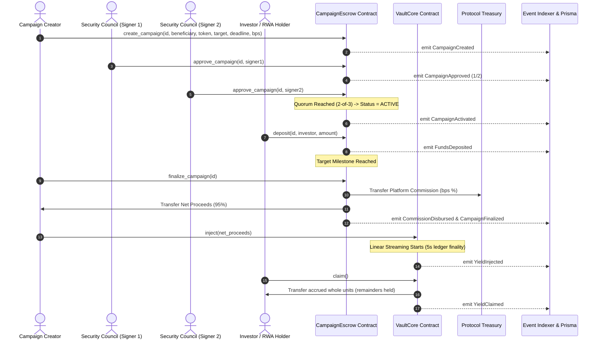

# YieldBridge Core Protocol Engine

> High-performance, non-custodial yield streaming engine, multi-signature campaign escrow, and deterministic deployer factory built natively on Stellar Soroban (`#![no_std]`), backed by an enterprise-grade off-chain indexing and cryptographic sealing infrastructure.

[](https://github.com/YieldBridge-Labs/yieldbridge-core/actions/workflows/ci.yml)
[](https://stellar.org)
[](https://www.rust-lang.org)
[](https://stellar.org)
[](https://stellar.expert/explorer/testnet)
[](https://opensource.org/licenses/MIT)
[](https://github.com/semantic-release/semantic-release)

---

## Executive Summary

**YieldBridge** provides production-grade, zero-trust infrastructure for continuous, time-linear yield streaming, multi-signature campaign escrows, and deterministic contract factory deployment on the Stellar network. Built to the exact architectural standards of the reference [StormSale](https://github.com/StormSale/StormSale) protocol, YieldBridge bridges on-chain trust minimization with off-chain real-time data indexing and cryptographic compliance.

### Protocol Highlights & Reference Standard Alignment

| Dimension | Reference Protocol ([StormSale](https://github.com/StormSale/StormSale)) Standard | YieldBridge Core Implementation |
| :--- | :--- | :--- |
| **Smart Contract Core** | `#![no_std]` Rust, zero floats, checked arithmetic | Soroban SDK v28, Rust Edition 2024, 128-bit fixed-point scaling ($10^{12}$) |
| **Storage & TTL Policy** | Optimal threshold-based auto-bump on persistent keys | 535,680 ledgers (~31 days) target with 100,000 threshold check on all reads/writes |
| **Governance & Approval**| M-of-N multi-sig security council campaign activation | 2-of-3 multi-signature quorum requirement in `campaign_escrow` |
| **Commission Routing** | Atomic platform fee deduction on 5-second ledger close | Sub-second atomic fee split to treasury and net proceeds to beneficiary |
| **Off-Chain Indexing** | Soroban RPC event polling + Serverless PostgreSQL | Prisma ORM, 5s ledger synchronization loop, transactional event normalization |
| **Webhook Integration** | Tamper-proof notifications with retry backoff & jitter | HMAC-SHA256 signature (`X-YieldBridge-Signature`), 5 retries, host rate limiting |
| **Security & Compliance**| Zero-trust cryptographic sealing for auditor inspection | AES-256-GCM authenticated payload sealing + ECDH X25519 key encapsulation |
| **Release Automation** | Conventional commits, semantic versioning, CI WASM release | `.releaserc.json`, dual-branch (`dev` -> `main`) git workflow, automated CI/CD |

---

## Protocol Architecture

### 1. End-to-End System Topology

```
+---------------------------------------------------------------------------------------------------------+
|                                        STELLAR SOROBAN PROTOCOL                                         |
|                                                                                                         |
|   +--------------------------+       +--------------------------+       +---------------------------+   |
|   |      stream_factory      |       |        vault_core        |       |      campaign_escrow      |   |
|   | Deterministic Deployer   | ----> | - $10^{12}$ accumulator  | <---> | - 2-of-3 Multi-Sig Quorum |   |
|   | 32-byte salt registry    |       | - Linear emission stream |       | - Atomic Commission Split |   |
|   | Auto-bump TTL 535,680    |       | - Fractional remainder   |       | - Target Milestone / Refund|  |
|   +--------------------------+       +--------------------------+       +---------------------------+   |
+--------------------------------------------+------------------------------------------------------------+
                                             | Emits Structured Events (`#[contractevent]`)
                                             v
+---------------------------------------------------------------------------------------------------------+
|                                      YIELD_BRIDGE BACKEND INDEXER                                       |
|                                                                                                         |
|   +-------------------------+     +--------------------------+     +--------------------------------+   |
|   |   Soroban RPC Poller    |     |   Prisma / PostgreSQL    |     |     REST API & Webhooks        |   |
|   | - 5-sec Ledger Cursor   | --> | - Serverless PostgreSQL  | --> | - Express / TypeScript API     |   |
|   | - Topic XDR Normalizer  |     | - Transactional batches  |     | - HMAC-SHA256 Signatures       |   |
|   | - Re-org Resilient Sync |     | - Indexed State Mirrors  |     | - Jittered Exponential Backoff |   |
|   +-------------------------+     +--------------------------+     +--------------------------------+   |
|                                                                                                         |
|   +-------------------------------------------------------------------------------------------------+   |
|   |                       ZERO-TRUST CRYPTOGRAPHIC SEALING ENGINE (Track 5)                         |   |
|   | - AES-256-GCM Authenticated Encryption with 96-bit random IV and 128-bit authentication tag     |   |
|   | - ECDH X25519 Key Encapsulation (HKDF-SHA256) for Authorized Regulatory & Auditor Disclosures  |   |
|   +-------------------------------------------------------------------------------------------------+   |
+---------------------------------------------------------------------------------------------------------+
```

### 2. Multi-Sig Campaign & Yield Streaming Sequence



---

## Directory Structure

```
yieldbridge-core/
├── .cargo/
│   └── config.toml                  # Cargo configuration & wasm flags
├── .github/
│   ├── workflows/
│   │   ├── ci.yml                   # Rust fmt, clippy, cargo audit, wasm build (<64KB)
│   │   └── release.yml              # Semantic release with WASM asset upload
│   └── pull_request_template.md     # Governance PR checklist & zero-trust template
├── contracts/
│   ├── vault_core/                  # Linear streaming vault engine
│   │   ├── Cargo.toml
│   │   └── src/
│   │       ├── lib.rs               # $10^{12}$ accumulator, remainder retention, TTL bump
│   │       └── test.rs              # 18 unit tests (overflow, rollover, precision)
│   ├── stream_factory/              # Deterministic deployment & registry
│   │   ├── Cargo.toml
│   │   └── src/
│   │       ├── lib.rs               # deploy_contract with 32-byte salt
│   │       └── test.rs              # 8 unit tests (collision, admin overrides)
│   └── campaign_escrow/             # Multi-sig governance & atomic commission
│       ├── Cargo.toml
│       └── src/
│           ├── lib.rs               # 2-of-3 quorum, atomic fee split, auto-bump TTL
│           └── test.rs              # 6 unit tests (quorum, refund, commission, TTL)
├── indexer/                         # Backend data indexing & cryptographic suite
│   ├── package.json                 # Node.js, Express, Stellar SDK, Prisma
│   ├── tsconfig.json                # Strict TypeScript configuration
│   ├── eslint.config.js             # Flat config with typescript-eslint rules
│   ├── prisma/
│   │   └── schema.prisma            # PostgreSQL schema for Vaults, Campaigns, Events
│   ├── src/
│   │   ├── types.ts                 # Zod validation schemas & normalized events
│   │   ├── crypto.ts                # AES-256-GCM data sealing & ECDH X25519 encapsulation
│   │   ├── webhook.ts               # HMAC-SHA256 dispatcher with jittered backoff
│   │   ├── indexer.ts               # Soroban RPC event stream poller & Prisma sync
│   │   └── api.ts                   # Express REST API service with compliance routes
│   └── tests/
│       ├── crypto.test.ts           # Vitest suite for AES-256-GCM & ECDH key exchange
│       └── webhook.test.ts          # Vitest suite for HMAC signing & delivery retry
├── scripts/
│   ├── deploy.sh                    # Automated Bash testnet deployment & setup
│   └── deploy.ps1                   # Automated PowerShell testnet deployment
├── src/
│   └── lib.rs                       # Top-level workspace exports
├── tests/
│   └── integration_test.rs          # 4 end-to-end integration tests
├── .gitignore
├── .releaserc.json                  # Semantic release configuration & rules
├── Cargo.toml                       # Top-level workspace manifest
├── CONTRIBUTING.md                  # Dev branch workflow & Conventional Commits
├── LICENSE                          # MIT License
├── README.md                        # Executive protocol specification
├── SECURITY.md                      # Vulnerability disclosure & zero-trust policy
└── SUBMISSION.md                    # Drips Stellar Wave submission manifest
```

---

## On-Chain Testnet Deployments

YieldBridge Core contracts are deployed and verified on **Stellar Testnet**:

| Contract / Artifact | Address / Hash | Explorer Link |
| :--- | :--- | :--- |
| **Stream Factory** | `CDXFFV6Y5ZLIWECDCFDJAR3NVZCI6DK6IBQG2CCGBTC6Q5ER6ZKSW47V` | [View Contract](https://stellar.expert/explorer/testnet/contract/CDXFFV6Y5ZLIWECDCFDJAR3NVZCI6DK6IBQG2CCGBTC6Q5ER6ZKSW47V) |
| **Vault Core WASM Template** | `c6734622b3ba1b0f1a199fbf6e5b567fc4738fa3dcdc71a51c8cc37cfa144221` | [View Upload Tx](https://stellar.expert/explorer/testnet/tx/cfb6a827745377d7577813ba265f18a81a9e51982b87d79f46018996e219610a) |
| **Stream Factory WASM** | `dda1a2a80a34bf6ea47beca294651473260c117538336555a5afce8eafcd079d` | [View Upload Tx](https://stellar.expert/explorer/testnet/tx/e83f076a8d938a61e8cfc3e0f5519c36656e160105bf2465897101b5f28ca85d) |
| **Campaign Escrow WASM** | `678192a83103e5998ac335e60097ffbcb42a4c88d9d995d7d06ac6731b1fc80c` | [View Binary Artifact](https://stellar.expert/explorer/testnet) |
| **Standalone Vault Instance** | `CATTLZBOWDCBHE3BSG5TKXYANDVLG6OLJUUT66PDUO3IUMYHZQOWGB7Z` | [View Contract](https://stellar.expert/explorer/testnet/contract/CATTLZBOWDCBHE3BSG5TKXYANDVLG6OLJUUT66PDUO3IUMYHZQOWGB7Z) |
| **Admin Deployer Account** | `GA23MAON7RAVLAZLWSF47WMEBY566IPUQL4MQVFSADCNEWCETXBV7TVR` | [View Account](https://stellar.expert/explorer/testnet/account/GA23MAON7RAVLAZLWSF47WMEBY566IPUQL4MQVFSADCNEWCETXBV7TVR) |

---

## Smart Contract Specifications

### 1. `campaign_escrow` (`contracts/campaign_escrow/`)

Multi-signature governance and milestone-driven escrow contract with atomic commission disbursements:

| Method | Parameters | Access | Description |
|---|---|---|---|
| `initialize` | `admin: Address`, `treasury: Address`, `threshold: u32`, `signers: Vec<Address>` | `admin` | Initializes escrow with multi-sig signers and platform treasury. |
| `create_campaign` | `campaign_id: u32`, `creator: Address`, `beneficiary: Address`, `token: Address`, `target_amount: i128`, `duration: u64`, `commission_bps: u32` | `creator` | Proposes new campaign requiring multi-sig activation. |
| `approve_campaign` | `campaign_id: u32`, `signer: Address` | `signer` | Authorizes pending campaign. Activates upon reaching quorum threshold. |
| `deposit` | `campaign_id: u32`, `investor: Address`, `amount: i128` | `investor` | Escrows funds into active campaign. |
| `finalize_campaign`| `campaign_id: u32` | Public | Atomically routes commission to treasury and net funds to beneficiary. |
| `claim_refund` | `campaign_id: u32`, `investor: Address` -> `i128` | `investor` | Returns 100% of deposited capital if campaign expired before target. |
| `get_campaign` | `campaign_id: u32` -> `Campaign` | View | Returns full campaign metadata and status. Auto-bumps persistent TTL. |
| `configuration` | `()` -> `(Address, Address, u32, u32)` | View | Returns `(admin, treasury, threshold, total_signers)`. Auto-bumps TTL. |

### 2. `vault_core` (`contracts/vault_core/`)

Continuous time-linear yield streaming engine with discrete checkpoint math:

| Method | Parameters | Access | Description |
|---|---|---|---|
| `initialize` | `admin: Address`, `token: Address`, `duration: u64` | `admin` | Sets vault parameters and reward asset. |
| `set_weights` | `investors: Vec<Address>`, `weights: Vec<u128>` | `admin` | Batch-updates share allocations after settling prior accruals. |
| `set_shares` | `investor: Address`, `shares: i128` | `admin` | Single-investor allocation helper. |
| `inject` | `amount: i128` | `admin` | Deposits reward tokens, rolling unvested amounts into new window. |
| `claim` | `investor: Address` -> `i128` | `investor` | Transfers accrued whole units and retains sub-atomic remainders. |
| `claimable` | `investor: Address` -> `i128` | View | Computes pending claimable units without modifying storage. |
| `configuration` | `()` -> `(Address, Address, u64)` | View | Returns `(admin, token, stream_duration)`. |

### 3. `stream_factory` (`contracts/stream_factory/`)

Deterministic deployment and registry engine:

| Method | Parameters | Access | Description |
|---|---|---|---|
| `initialize` | `admin: Address`, `vault_wasm_hash: BytesN<32>` | `admin` | Sets factory administrator and template hash. |
| `set_vault_wasm_hash`| `vault_wasm_hash: BytesN<32>` | `admin` | Updates default WASM template for child deployments. |
| `create_vault` | `salt: BytesN<32>`, `token: Address`, `duration: u64` -> `Address` | `admin` | Deterministically deploys child vault via native `deploy_contract`. |
| `vault_for_salt` | `salt: BytesN<32>` -> `Option<Address>` | View | Resolves 32-byte salt to deployed contract address. |

---

## Quick Start & Verification Runbook

### 1. Smart Contract Verification (Rust)

```bash
# 1. Format check
cargo fmt --all -- --check

# 2. Static analysis and zero-warning policy
cargo clippy --all-targets -- -D warnings

# 3. Execute all 36 workspace unit and integration tests
cargo test --workspace --all-targets

# 4. Build optimized WebAssembly binaries
stellar contract build --package vault_core
stellar contract build --package stream_factory
stellar contract build --package campaign_escrow
```

### 2. Backend Indexer & Cryptographic Suite Setup

```bash
cd indexer

# 1. Install dependencies
npm install

# 2. Run TypeScript linter
npm run lint

# 3. Generate Prisma client & run database migrations
npm run prisma:generate
npm run prisma:migrate

# 4. Execute cryptographic & webhook test suites
npm test

# 5. Start indexer poller & REST API service
npm run indexer:start
npm run start
```

---

## Governance & Release Policy

1. **Dual-Branch Workflow:**
   - All feature branches and bug fixes must open pull requests targeting the **`dev`** branch.
   - Merges into `main` are reserved exclusively for production releases.
2. **Commit Message Format:**
   - Strictly conforms to the **Conventional Commits** specification (`feat`, `fix`, `perf`, `security`, `test`, `docs`).
3. **Automated Semantic Releases:**
   - Powered by `.releaserc.json`. Automated changelog generation (`CHANGELOG.md`), GitHub Release creation, and deployment of compiled `.wasm` artifacts (`vault_core.wasm`, `stream_factory.wasm`, `campaign_escrow.wasm`).

---

## Maintainers & Protocol Contacts

| Role | Name | GitHub / Contact |
| :--- | :--- | :--- |
| **Lead Protocol Architect** | Mutech939 | [@Mutech939](https://github.com/Mutech939) |
| **Security Coordination** | YieldBridge Security | `security@yieldbridge.io` |
| **Protocol Repository** | YieldBridge Labs | [GitHub Org](https://github.com/YieldBridge-Labs) |

---

## License

This project is licensed under the [MIT License](LICENSE).
